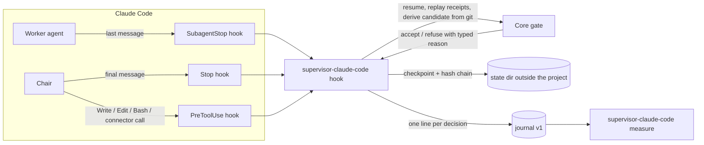

# coding-supervisor

**A portable coding-agent supervisor that coordinates delegation and requires verifiable, current evidence before accepting task completion.**

It sits beside an existing coding harness. The harness keeps the model, the tools and the execution environment. The supervisor keeps one small, deterministic rule: a task is complete only when every mandatory check has a current receipt, bound to the exact candidate that was checked, produced by a command the harness actually observed. A worker saying "tests passed" is not evidence. A worker saying it would run the tests is not evidence. A receipt for yesterday's version of the file is not evidence.

> [!IMPORTANT]
> **Status, as of 2026-10-29: first slice complete, not yet used on a real project.** The core and one adapter exist, are tested, and were proven live in an isolated fixture on Claude Code 2.1.312. Nothing here has supervised real work yet, and no claim is made that it improves verified work per token. That claim is the next thing to measure, not a result.

## What exists

| Part | Where | What it does | Verified by |
|---|---|---|---|
| Core gate | `src/lib.rs` | Records `TaskContract`, `Candidate`, `VerificationReceipt`, `Finding`, `Checkpoint`; a ten-state task machine; freshness invalidation when the candidate changes; a bounded repair budget; typed errors, no panics, no `unsafe`, **no dependencies** | 33 scenario tests in `tests/scenarios.rs`, including a declared state-by-event transition matrix |
| Claude Code adapter | `adapters/claude-code/` | The `supervisor-claude-code` binary, run by Claude Code hooks. Parses a worker's verdict header, links cited checks to commands the harness observed, drives the core, refuses unsupported completion claims, denies writes to its own state, detects tampering with a hash chain, journals every decision | 8 parser, 20 protection, 19 replay and 4 measure tests; three live fixture runs documented in `docs/research/2026-10-28-completion-gate-first-slice/T3-RESULTS.md` and `T4-T5-RESULTS.md` |
| Measurement reader | `supervisor-claude-code measure` | Turns the adapter's journals into gate-derived numbers: dispatches, supported and unsupported passes, linked receipts, refusals by reason, accepted tasks, worker tokens per accepted task | `T6-RESULTS.md` |
| Fixture | `fixtures/claude-code-enforcement/` | A throwaway project with its own hook settings, a contract, controlled fake workers and captured hook events, used for every live test | the results files above |

The only dependency in the whole workspace is `serde_json`, in the adapter, for reading hook payloads from stdin. The core's dependency tree is one line.

## How it works



A worker ends its turn with a fixed header:

```
VERDICT: PASS | FAIL | UNVERIFIED
CHECKS RUN: <n>
<command>  exit <code>
...
```

The adapter turns each cited command into a receipt only if the harness observed that command run under the same agent. A `PASS` with no linked receipt is refused at `SubagentStop`. A chair that claims completion while the gate is not in `completed` is refused at `Stop`. A write while the task is terminal, or any attempt to touch the gate's own state through any known tool, is denied at `PreToolUse`.

## What the adapter can and cannot enforce

The first line of `adapters/claude-code/src/lib.rs` declares the mode, measured rather than assumed:

- **Enforcing** at `SubagentStop`, `Stop` and `PreToolUse`. The two stop hooks are bounded by the harness's cap of eight consecutive continuations; the adapter refuses, then releases visibly rather than looping.
- **Advisory** at `PostToolUse`, which can annotate a foreground worker's result but cannot stop the chair, and which never fires for a background dispatch.
- **No event exists** at the moment the chair accepts a worker's claim. That moment is implicit in the model's reasoning.

> [!WARNING]
> These measures raise the bar and detect tampering. They do **not** make the adapter enforcing against an adversarial agent that holds a shell as the same OS user. Such an agent can spell the state path differently, delete the state, edit the hook settings, or replace the binary. The guard matches on tool name and known input fields only; a tool outside its list, or a field it does not read, is uncovered. Treat the gate as protection against sloppy or self-deceiving agents, not hostile ones.

## What is deliberately not done

| Item | State |
|---|---|
| `forbidden_effects` on the contract | Declared, **not enforced**. Nothing observes effects yet. Enforcement needs adapter-supplied observations and an effect history that survives candidate changes and resume. |
| Blocked as a resumable paused state | The core treats `blocked` as terminal. The inherited specification lists it under "terminal/paused". An explicit unblock operation is a declared gap awaiting a decision. |
| Repair rounds and findings through the adapter | The core models them; the adapter emits no repair or finding events yet. |
| Candidate identity from uncommitted content | The core compares identities; the adapter derives one from git. Detecting real content changes is the adapter's job and is tested only with synthetic identities in the core. |
| Delegation (which agent should do the work) | Advisory only, and not part of this slice. An existing routing engine on the author's machine is reused where relevant; nothing here routes. |
| Other harnesses | Only Claude Code. Each future adapter must declare, on its first line, what it can observe and what it can block. |

## What still needs to happen

1. **Use it on a real project.** Delete any gate state written before the hash chain existed, install the hook configuration from the fixture's `settings-adapter.json` into the project, write a contract, and let it supervise real work. This is the first time the gate meets real workers.
2. **Measure.** Compare sessions with and without the gate on matched tasks: accepted tasks, defects escaped, unsupported passes, retries, tokens and wall time, with failed attempts counted. Gate-derived numbers from the journal stay separate from transcript-derived numbers.
3. **Decide blocked-state semantics** and implement unblock if paused is chosen, with the rule that unblocking never grants acceptance, resets the repair budget, or restores stale evidence.
4. **Effects.** Design the observation contract before implementing enforcement of `forbidden_effects`.
5. **Second adapter.** Only after the first is in use, and with its own measured mode line.

## Build and test

Requires the pinned toolchain in `rust-toolchain.toml` (Rust 1.99.1). Build artifacts are kept outside the checkout on the author's machine; set `CARGO_TARGET_DIR` as you prefer.

```bash
cargo test --workspace
cargo fmt --check
cargo clippy --all-targets -- -D warnings
cargo tree -p coding-supervisor -e normal,build,dev --target all   # one line: the core has no dependencies
```

Run the adapter as a hook (one payload on stdin, at most one decision on stdout):

```bash
supervisor-claude-code hook
```

Read gate-derived numbers from one or more journals:

```bash
supervisor-claude-code measure [--json] <path>...
```

State lives, in order of preference, under `SUPERVISOR_STATE_DIR`, then the platform's local app data or XDG state directory under `coding-supervisor/state/<project key>/`, and only as a last resort under `.supervisor/` in the working directory. The rule chosen is journaled on every event.

## Repository map

| Path | Content |
|---|---|
| `CLAUDE.md` | Live truth for this repository: definition, scope, principles, current state |
| `HANDOVER.md` | Self-contained state for the next working session, with the paths and hashes of the research this builds on |
| `docs/research/2026-10-28-completion-gate-first-slice/` | The plan and the results of each task, with commands and exit codes |
| `docs/archive/inherited-specs/` | The two specifications this inherits from, preserved byte-identical |
| `src/`, `tests/` | The core and its scenarios |
| `adapters/claude-code/` | The Claude Code adapter crate |
| `fixtures/claude-code-enforcement/` | The live-test fixture and captured hook events |

## Provenance

This repository grew out of a study of when to fold specialist agents into one agent loop, applied to coding. The conclusion that shaped it: in the author's own session corpus, the independent verifier caught real defects and was worth keeping, but one accept in seven was issued with no command run, and almost no judge cited the command it ran against the claim it supported. The gate exists to make that impossible by construction rather than by instruction. The research and measurement that led here live in a separate repository on the author's machine and are referenced from `HANDOVER.md` by path and hash.

License: MIT.
