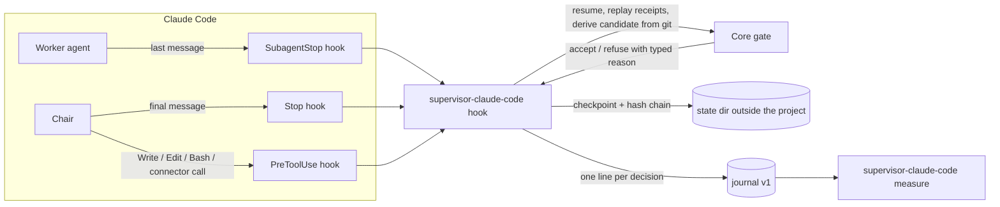

# coding-supervisor

**A portable coding-agent supervisor that coordinates delegation and requires verifiable, current evidence before accepting task completion.**

It sits beside an existing coding harness. The harness keeps the model, the tools and the execution environment. The supervisor keeps one small, deterministic rule: a task is complete only when every mandatory check has a current receipt, bound to the exact candidate that was checked, produced by a command the harness actually observed. A worker saying "tests passed" is not evidence. A worker saying it would run the tests is not evidence. A receipt for yesterday's version of the file is not evidence.

> [!IMPORTANT]
> **Status, as of 2026-10-29: first slice complete and installable on one harness, not yet used on a real project.** The core and one hook adapter exist, are tested, and were proven live in an isolated fixture on Claude Code 2.1.312. Phase A added a command-line installer, an MCP server and install support for five harnesses (Claude Code, Codex CLI, Cursor, OMP, Grok Build); only Claude Code has been run live through the installed configuration, in a throwaway project. Nothing here has supervised real work yet, and no claim is made that it improves verified work per token. That claim is the next thing to measure, not a result.

## What exists

| Part | Where | What it does | Verified by |
|---|---|---|---|
| Core gate | `src/lib.rs` | Records `TaskContract`, `Candidate`, `VerificationReceipt`, `Finding`, `Checkpoint`; a ten-state task machine; freshness invalidation when the candidate changes; a bounded repair budget; typed errors, no panics, no `unsafe`, **no dependencies** | 33 scenario tests in `tests/scenarios.rs`, including a declared state-by-event transition matrix |
| Claude Code adapter | `adapters/claude-code/` | The `supervisor-claude-code` binary, run by Claude Code hooks. Parses a worker's verdict header, links cited checks to commands the harness observed, drives the core, refuses unsupported completion claims, denies writes to its own state, detects tampering with a hash chain, journals every decision | 8 parser, 20 protection, 23 replay and 5 measure tests (counted from `#[test]` attributes, as_of 2026-10-29; the suite was not rerun for this edit); three live fixture runs documented in `docs/research/2026-10-28-completion-gate-first-slice/T3-RESULTS.md` and `T4-T5-RESULTS.md` |
| Measurement reader | `supervisor-claude-code measure` | Turns the adapter's journals into gate-derived numbers: dispatches, supported and unsupported passes, linked receipts, refusals by reason, accepted tasks, worker tokens per accepted task | `T6-RESULTS.md` |
| Fixture | `fixtures/claude-code-enforcement/` | A throwaway project with its own hook settings, a contract, controlled fake workers and captured hook events, used for every live test | the results files above |
| MCP server (advisory) | `adapters/mcp/` | The `supervisor-mcp` binary: eight tools over the same gate state as the hooks (`task_start`, `candidate_observe`, `receipt_record`, `finding_raise`, `repair_request`, `accept_try`, `task_complete`, `task_state`), newline-delimited JSON-RPC on stdin and stdout. Answers; never blocks. Receipts are caller-asserted | 20 tests (6 protocol, 13 replay, 1 journal; `#[test]` count, not rerun for this edit); one live Claude Code session in `A-RESULTS.md` (S3b) |
| Command-line installer | `cli/` | The `supervisor` binary: `init`, `install --harness`, `hook`, `mcp`. Writes the two skills and the gate's registration into a project for one of five harnesses | 10 tests (9 install, 1 init; `#[test]` count, not rerun for this edit); Claude Code installed configuration run live in `A-RESULTS.md` |
| Skill templates | `skills/` | `supervisor-chair` and `supervisor-worker`, rendered per harness by `install` | rendered text shown in the install runs below |
| Install fixture | `fixtures/claude-code-install/` | The runner, contract and captured hook and tool journals from the live sessions through the installed configuration | `docs/research/2026-10-29-installable/A-RESULTS.md` |
| CI and release workflows | `.github/workflows/ci.yml`, `release.yml` | CI on every push and pull request: format, lint, tests, and a check that the core has no dependencies. Release on a `v*` tag: native release builds for four targets, archives with checksums, a GitHub release | **Unverified.** No tag exists, no workflow run has been observed, and no remote-tracking branch for `phase-a-installable` exists locally (as_of 2026-10-29) |

The core has no dependencies; its dependency tree is one line. The only dependency in the workspace is `serde_json`, used by the Claude Code adapter (to read hook payloads from stdin), by the MCP server and by the command-line installer.

## Install and use

Status, as of 2026-10-29: Claude Code is the only harness run live through the installed configuration (`docs/research/2026-10-29-installable/A-RESULTS.md`, throwaway project). For Codex CLI, Cursor, OMP and Grok, install writes files whose locations come from each harness's documentation (`docs/research/2026-10-29-installable/HARNESS-LOCATIONS.md`); none of those harnesses has been recorded loading them yet. Phase B is that check.

### The three binaries

| Binary | Commands | What it does |
|---|---|---|
| `supervisor` | `init [--project <dir>]`, `install --harness <name> [--project <dir>] [--home <dir>] [--binary <path>] [--dry-run]`, `hook`, `mcp [--project <dir>]` | The single entry point. `hook` behaves exactly as `supervisor-claude-code hook`; `mcp` serves the gate as an MCP server |
| `supervisor-mcp` | `[--project <dir>]` | The MCP server on its own; same as `supervisor mcp` |
| `supervisor-claude-code` | `hook`, `measure [--json] <path>...` | The Claude Code hook adapter and the journal reader. `measure` exists only here |

Harness names for `--harness`: `claude-code`, `codex`, `cursor`, `omp`, `grok`.

### Get the binaries

- **From a release.** The release workflow builds on a `v*` tag for `x86_64-pc-windows-msvc`, `x86_64-unknown-linux-gnu`, `aarch64-apple-darwin` and `x86_64-apple-darwin`, and attaches `coding-supervisor-<tag>-<target>.zip` (Windows) or `.tar.gz` holding the three binaries, a `.sha256` file per archive and a combined `SHA256SUMS`. **No release exists yet**: no tag has been pushed and the workflow has never run.
- **From source.** With the toolchain pinned in `rust-toolchain.toml` (Rust 1.99.1): `cargo build --release --workspace`. The binaries are in `target/release/` under your `CARGO_TARGET_DIR`, or under `target/` if it is unset.

Put the binaries where they will stay. `install` writes the absolute path of the running `supervisor` into the hook and MCP files (override with `--binary <path>`), so moving the binary later breaks the installed configuration.

### Quickstart, any harness

1. `supervisor init --project <project>` writes a starting contract into the gate's state directory (outside the project) and never overwrites one. The runs below used `SUPERVISOR_STATE_DIR=C:\temp\sup-throwaway\state`, a throwaway project at `C:\temp\sup-throwaway\proj`, and the debug build; output as printed on 2026-10-29, exit 0:

   ```text
   project: C:\temp\sup-throwaway\proj
   state directory: C:\temp\sup-throwaway\state\C--temp-sup-throwaway-proj (rule: env)
   contract exists, left unchanged: C:\temp\sup-throwaway\state\C--temp-sup-throwaway-proj\contract.json
   Edit the contract's goal, criteria and scope there, then register the gate with one of:
     supervisor install --harness claude-code --project C:\temp\sup-throwaway\proj
     …
     supervisor install --harness grok --project C:\temp\sup-throwaway\proj
   ```

   On a fresh state directory it prints `contract written:` instead. The starting contract (from `cli/src/init.rs`) has criteria C1 to C4 with only C2 and C3 mandatory, scope `src/` and `tests/`, and two repair rounds. Edit its goal, criteria and scope.
2. `supervisor install --harness <name> --project <project>`. Add `--dry-run` to print what would change and write nothing. Running it again is safe: files already up to date print `no changes: every file is already up to date`.
3. Do the manual step install prints at the end. Install never performs it.

Install writes, per harness, two skills (`supervisor-worker`, `supervisor-chair`) into the project's skills directory and the registration of the MCP server `supervisor` (run as `<binary> mcp --project <project>`) into the project's MCP file. Only Claude Code also gets hooks.

### Claude Code

Writes `.claude/skills/<skill>/SKILL.md` (two files), `.mcp.json`, and `.claude/settings.json` with the six hook events (`UserPromptSubmit`, `PreToolUse`, `PostToolUse`, `PostToolUseFailure`, `SubagentStop`, `Stop`) and a `permissions.allow` entry `mcp__supervisor`. If a `.gitignore` already exists and does not list it, it also adds `.supervisor/`.

Dry run into an empty directory (the `<<skill text>>` markers replace the printed file bodies; hook entries trimmed to one event with `…`):

```text
install Claude Code into C:\temp\sup-throwaway\fresh (dry run)
--- /dev/null
+++ C:\temp\sup-throwaway\fresh\.claude\skills\supervisor-worker\SKILL.md
<<skill text>>
--- /dev/null
+++ C:\temp\sup-throwaway\fresh\.claude\skills\supervisor-chair\SKILL.md
<<skill text>>
--- /dev/null
+++ C:\temp\sup-throwaway\fresh\.mcp.json
+{
+  "mcpServers": {
+    "supervisor": {
+      "args": [
+        "mcp",
+        "--project",
+        "C:/temp/sup-throwaway/fresh"
+      ],
+      "command": "C:/Target/coding-supervisor/main/target/debug/supervisor.exe",
+      "type": "stdio"
+    }
+  }
+}
--- /dev/null
+++ C:\temp\sup-throwaway\fresh\.claude\settings.json
+{
+  "hooks": {
+    …
+    "Stop": [
+      {
+        "hooks": [
+          {
+            "command": "C:/Target/coding-supervisor/main/target/debug/supervisor.exe hook",
+            "type": "command"
+          }
+        ]
+      }
+    ],
+    …
+  },
+  "permissions": {
+    "allow": [
+      "mcp__supervisor"
+    ]
+  }
+}
dry run: nothing written
note: JSON files are rewritten with two-space indentation; keys are written in sorted order.
```

The same command against the already installed throwaway project (exit 0):

```text
install Claude Code into C:\temp\sup-throwaway\proj (dry run)
no changes: every file is already up to date
dry run: nothing written
```

Manual step, as printed:

```text
manual step (not performed): Trust the project folder once: start Claude Code interactively here and accept the trust dialog. Until then Claude Code ignores the `permissions.allow` entry for `mcp__supervisor` that install wrote, and every gate tool call is refused (seen live, A-RESULTS.md session S3c). Interactive sessions also ask once to approve the project MCP server `supervisor` from .mcp.json: approve it. `claude -p` loads it without asking (section 1, row 3).
```

### Codex CLI

Writes `.agents/skills/<skill>/SKILL.md` (two files) and `.codex/config.toml`. No hooks. Dry run into an empty directory with `--binary supervisor` (skill bodies omitted):

```text
install Codex CLI into C:\temp\sup-throwaway\fresh (dry run)
…
--- /dev/null
+++ C:\temp\sup-throwaway\fresh\.codex\config.toml
+[mcp_servers.supervisor]
+command = "supervisor"
+args = ["mcp", "--project", "C:/temp/sup-throwaway/fresh"]
dry run: nothing written
```

Against the throwaway project, which had been installed before the chair skill changed, install shows the update as a diff (exit 0):

```text
install Codex CLI into C:\temp\sup-throwaway\proj (dry run)
--- C:\temp\sup-throwaway\proj\.agents\skills\supervisor-chair\SKILL.md
+++ C:\temp\sup-throwaway\proj\.agents\skills\supervisor-chair\SKILL.md
-1. Observe the candidate: `candidate_observe` with the current commit and a
-   digest of the uncommitted changes, plus the changed paths. If the files
-   changed since the last receipt, the gate marks those receipts stale.
+1. Observe the candidate: call `candidate_observe` with no identity fields.
+   The gate reads git itself (the current commit, a digest of the uncommitted
+   changes and the changed paths), the same way its hooks do. Pass
+   `base_commit`, `dirty_digest` and `changed_paths` only on a harness
+   without git. If the files changed since the last receipt, the gate marks
+   those receipts stale.
dry run: nothing written
```

Manual step, as printed (the home directory was `--home C:\temp\sup-throwaway\home`):

```text
manual step (not performed): Trust the project so Codex loads .codex/config.toml: add these lines to C:/temp/sup-throwaway/home/.codex/config.toml
    [projects.'C:\temp\sup-throwaway\proj']
    trust_level = "trusted"
  (section 2, row 3; the Windows spelling of that key follows this machine's config, not a documented rule: gap G3).
```

### Cursor

Writes `.cursor/skills/<skill>/SKILL.md` (two files) and `.cursor/mcp.json` (the same JSON shape as `.mcp.json` above). No hooks. Against the throwaway project, exit 0: the same chair-skill hunk as for Codex, with the path `C:\temp\sup-throwaway\proj\.cursor\skills\supervisor-chair\SKILL.md`, then `dry run: nothing written`. Manual step, as printed:

```text
manual step (not performed): Approve the server once: run `cursor-agent mcp enable supervisor` in the project, or pass `--approve-mcps` in scripted runs (section 3, row 3; whether this covers project servers only is gap G4a). On this machine the bare `agent` command is not Cursor; use `cursor-agent`.
```

### OMP

Writes `.omp/skills/<skill>/SKILL.md` (two files) and `.omp/mcp.json`. No hooks: OMP hooks are code modules, and install does not write one. Against the throwaway project, exit 0: the same chair-skill hunk for `…\.omp\skills\supervisor-chair\SKILL.md`, then `dry run: nothing written`. Manual step, as printed:

```text
manual step (not performed): None: OMP loads project MCP servers without approval (section 4, row 3).
```

### Grok Build

Writes `.grok/skills/<skill>/SKILL.md` (two files) and `.grok/config.toml` (same TOML table as Codex). No hooks: the documentation says Grok's hooks cannot refuse completion. Against the throwaway project, exit 0: the same chair-skill hunk for `…\.grok\skills\supervisor-chair\SKILL.md`, then `dry run: nothing written`. Manual step, as printed:

```text
manual step (not performed): Trust the folder once so Grok loads project MCP servers: start `grok --trust` in the project or run `/hooks-trust` (section 5, row 3; `--trust` is missing from the CLI reference: gap G5).
```

### Limits to know before relying on it

- **Receipts through the MCP tools are caller-asserted.** The first line of `adapters/mcp/src/lib.rs` declares the mode: `MODE: advisory via MCP on every harness; the server answers and never blocks; receipts are caller-asserted (the server does not observe commands). On Claude Code, the hook adapter ignores these receipts when it decides whether a completion may stop.` The server stores such a receipt with an `output_ref` starting `mcp-asserted:`. In the one live run that exercised this (`A-RESULTS.md`, S3b), the MCP path reached `completed` and the Claude Code `Stop` hook still refused the completion claim for a missing receipt. On the other four harnesses no hook is installed, so nothing there blocks.
- **Claude Code must trust the folder before the allow rule works.** In the run through the installed configuration alone (`A-RESULTS.md`, S3c) Claude Code printed that it was ignoring the `permissions.allow` entry because the workspace was not trusted, and denied the gate's tool call, while the hooks in the same file still ran. The run that reached the tools (S3b) added `--allowedTools mcp__supervisor` on the command line, which is not part of the installed configuration. A run of the installed configuration alone in a trusted folder has not been done.
- **JSON files are rewritten with sorted keys.** Install reads an existing `.mcp.json`, `.claude/settings.json` or `.cursor/mcp.json`, keeps what is there, adds its entries, and writes the whole file back with two-space indentation and keys in sorted order. Expect a reordered diff on a hand-written file. The TOML files are edited in place and only a plain `[mcp_servers.supervisor]` header line is recognised.
- **Nothing is written outside the project and home.** Install writes only under the project directory and refuses any path outside the project and the home directory (`--home`, default the user profile). The user-level harness configuration is never touched: user-level skills directories and trust settings appear only as printed notes and manual steps. The gate's own state lives in the state directory chosen by the rule described under "Build and test".

## How it works



A worker ends its turn with a fixed header:

```
VERDICT: PASS | FAIL | UNVERIFIED
CHECKS RUN: <n>
<command>  exit <code>
...
```

The adapter turns each cited command into a receipt only if the harness observed that command run under the same agent. A `PASS` with no linked receipt is refused at `SubagentStop`. A chair that claims completion while the gate is not in `completed` is refused at `Stop`. A write while the task is terminal, or any attempt to touch the gate's own state through any known tool, is denied at `PreToolUse`.

## What the adapter can and cannot enforce

The first line of `adapters/claude-code/src/lib.rs` declares the mode, measured rather than assumed:

- **Enforcing** at `SubagentStop`, `Stop` and `PreToolUse`. The two stop hooks are bounded by the harness's cap of eight consecutive continuations; the adapter refuses, then releases visibly rather than looping.
- **Advisory** at `PostToolUse`, which can annotate a foreground worker's result but cannot stop the chair, and which never fires for a background dispatch.
- **No event exists** at the moment the chair accepts a worker's claim. That moment is implicit in the model's reasoning.

> [!WARNING]
> These measures raise the bar and detect tampering. They do **not** make the adapter enforcing against an adversarial agent that holds a shell as the same OS user. Such an agent can spell the state path differently, delete the state, edit the hook settings, or replace the binary. The guard matches on tool name and known input fields only; a tool outside its list, or a field it does not read, is uncovered. Treat the gate as protection against sloppy or self-deceiving agents, not hostile ones.

## What is deliberately not done

| Item | State |
|---|---|
| `forbidden_effects` on the contract | Declared, **not enforced**. Nothing observes effects yet. Enforcement needs adapter-supplied observations and an effect history that survives candidate changes and resume. |
| Blocked as a resumable paused state | The core treats `blocked` as terminal. The inherited specification lists it under "terminal/paused". An explicit unblock operation is a declared gap awaiting a decision. |
| Repair rounds and findings through the adapter | The core models them; the adapter emits no repair or finding events yet. |
| Candidate identity from uncommitted content | The core compares identities; the adapter derives one from git. Detecting real content changes is the adapter's job and is tested only with synthetic identities in the core. |
| Delegation (which agent should do the work) | Advisory only, and not part of this slice. An existing routing engine on the author's machine is reused where relevant; nothing here routes. |
| Other harnesses | Only Claude Code has a hook adapter and a live run. For Codex CLI, Cursor, OMP and Grok, install writes skills and an MCP registration (advisory, caller-asserted receipts) and no hooks; none has been recorded loading them. Each future hook adapter must declare, on its first line, what it can observe and what it can block. |

## What still needs to happen

1. **Use it on a real project.** Delete any gate state written before the hash chain existed, run `supervisor init` and `supervisor install --harness claude-code` for the project, trust the folder in Claude Code, edit the contract, and let it supervise real work. This is the first time the gate meets real workers.
2. **Measure.** Compare sessions with and without the gate on matched tasks: accepted tasks, defects escaped, unsupported passes, retries, tokens and wall time, with failed attempts counted. Gate-derived numbers from the journal stay separate from transcript-derived numbers.
3. **Decide blocked-state semantics** and implement unblock if paused is chosen, with the rule that unblocking never grants acceptance, resets the repair budget, or restores stale evidence.
4. **Effects.** Design the observation contract before implementing enforcement of `forbidden_effects`.
5. **Phase B: live checks of the other four harnesses (in progress, as_of 2026-10-29).** Investigations for Codex CLI, Cursor, OMP and Grok Build, each producing one results file under `docs/research/2026-10-29-installable/` (named `<harness>-T3-RESULTS.md`, with fixtures under `fixtures/<harness>-enforcement/`). None is finished or committed yet. A hook adapter for any of them comes only after its results file, with its own measured mode line.
6. **Prove the workflows.** Push the branch, watch CI pass on all steps, then cut a tag and check the four archives, checksums and the release page. Until then the CI and release files are unverified.
7. **Installed Claude Code configuration in a trusted folder, without extra command-line flags.** The one run that reached the gate's MCP tools used `--allowedTools`; see the limits under "Install and use".

## Build and test

Requires the pinned toolchain in `rust-toolchain.toml` (Rust 1.99.1). Build artifacts are kept outside the checkout on the author's machine; set `CARGO_TARGET_DIR` as you prefer. The workspace has four crates: the core, `adapters/claude-code`, `adapters/mcp` and `cli`.

```bash
cargo build --release --workspace   # supervisor, supervisor-mcp, supervisor-claude-code
cargo test --workspace
cargo fmt --all -- --check
cargo clippy --workspace --all-targets -- -D warnings
cargo tree -p coding-supervisor -e normal,build,dev --target all   # one line: the core has no dependencies
```

These are the commands the CI workflow runs (it checks the one-line tree with `--edges normal,build,dev`). The CI workflow has not been observed running.

Run the adapter as a hook (one payload on stdin, at most one decision on stdout); `supervisor hook` does the same:

```bash
supervisor-claude-code hook
```

Serve the gate over MCP (the project defaults to the current directory):

```bash
supervisor mcp --project <dir>
```

Read gate-derived numbers from one or more journals:

```bash
supervisor-claude-code measure [--json] <path>...
```

State lives, in order of preference, under `SUPERVISOR_STATE_DIR`, then the platform's local app data or XDG state directory under `coding-supervisor/state/<project key>/`, and only as a last resort under `.supervisor/` in the working directory. The rule chosen is journaled on every event.

## Repository map

| Path | Content |
|---|---|
| `CLAUDE.md` | Live truth for this repository: definition, scope, principles, current state |
| `HANDOVER.md` | Self-contained state for the next working session, with the paths and hashes of the research this builds on |
| `docs/research/2026-10-28-completion-gate-first-slice/` | The plan and the results of each task, with commands and exit codes |
| `docs/archive/inherited-specs/` | The two specifications this inherits from, preserved byte-identical |
| `docs/research/2026-10-29-installable/` | Phase A results (`A-RESULTS.md`), the harness location survey (`HARNESS-LOCATIONS.md`), and in Phase B one results file per harness |
| `docs/research/2026-10-29-harness-capability-survey/` | The earlier capability survey for Codex CLI, Cursor, OMP and Grok Build |
| `src/`, `tests/` | The core and its scenarios |
| `adapters/claude-code/` | The Claude Code adapter crate |
| `adapters/mcp/` | The MCP server crate (`supervisor-mcp`), with its tool definitions in `src/tools.json` |
| `cli/` | The `supervisor` crate: `init`, `install`, `hook`, `mcp` |
| `skills/` | The chair and worker skill templates that `install` renders |
| `fixtures/claude-code-enforcement/` | The live-test fixture and captured hook events |
| `fixtures/claude-code-install/` | The runner, contract and captures for the live sessions through the installed configuration |
| `.github/workflows/` | `ci.yml` (every push and pull request) and `release.yml` (on `v*` tags); unverified until they have run |

## Provenance

This repository grew out of a study of when to fold specialist agents into one agent loop, applied to coding. The conclusion that shaped it: in the author's own session corpus, the independent verifier caught real defects and was worth keeping, but one accept in seven was issued with no command run, and almost no judge cited the command it ran against the claim it supported. The gate exists to make that impossible by construction rather than by instruction. The research and measurement that led here live in a separate repository on the author's machine and are referenced from `HANDOVER.md` by path and hash.

License: MIT.
