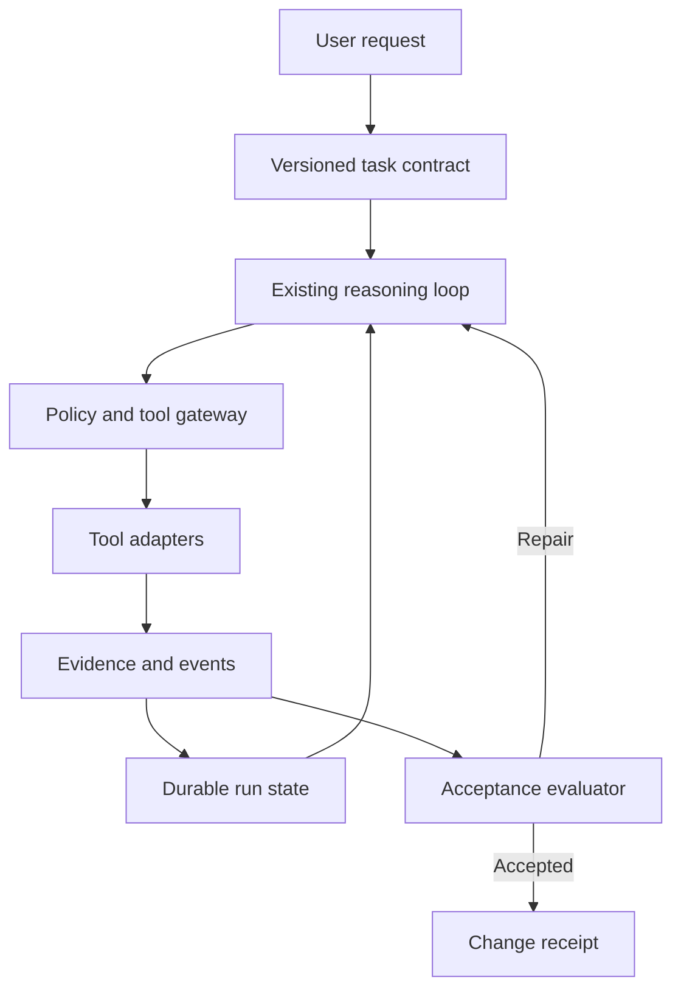

# Hermes harness engineering — research and integration ledger

Research date: 23 October 2026  
Target: a custom Hermes Agent fork  
Status: source review complete; integration design proposed; fork implementation not inspected

## 1. Purpose and evidence boundary

This file is an engineering handoff: a traceable inventory of the linked article, its visual material, and proposed ways to turn those ideas into executable behavior in a Hermes fork. It is not a replacement transcript or a claim that any feature below has been implemented.

The primary source is Lunar (@LunarResearcher), **Harness Engineering: The Complete Guide to Building AI Agents That Don't Fall Apart**, published 6 September 2026. [S1]

The original English article was read directly in the browser, including all 19 numbered sections, conclusion, code examples, and 13 images. A translated mirror helped locate the original but is not the authority for technical interpretation. [S2]

Three public replies were visible. They supplied reactions and an anecdote, rather than additional specifications. X offered a sign-in link for all replies, so this is not an exhaustive comment review. The article links to the author's Substack subscription and profile; it does not supply a reference implementation, benchmark dataset, or technical bibliography. Those promotional links were not treated as technical evidence.

The upstream Hermes repository and memory-provider documentation were checked for orientation. This was a documentation-level compatibility check, not a pinned source-code audit. Your fork URL, branch, commit, runtime configuration, and failure examples were not supplied. Consequently, every proposed integration location below is a responsibility to locate in your fork, not a verified function or filename.

### Reading conventions

- **Source cue:** a compact paraphrase of the author's idea, identified by article section.
- **Proposal:** my engineering design for applying it. These details are not attributed to the author.
- **Verified upstream:** supported by official Hermes documentation, with its limits stated.
- **Unresolved:** requires inspection or measurement in your fork.

## 2. Source idea inventory

The following compact cues cover the article's 19 sections. All are from [S1]; implementation details in later sections are original proposals.

| Ledger ID | Article section | Source cue |
|---|---:|---|
| H01 | 1 | Engineer the surrounding system. |
| H02 | 2 | Contract before execution. |
| H03 | 3 | Retrieve context progressively. |
| H04 | 4 | Mediate tools centrally. |
| H05 | 5 | Separate reasoning, execution, history. |
| H06 | 6 | Persist explicit working state. |
| H07 | 7 | Require completion evidence. |
| H08 | 8 | Verify adversarially. |
| H09 | 9 | Enforce policy outside reasoning. |
| H10 | 10 | Classify failures before recovery. |
| H11 | 11 | Automate recurring rules. |
| H12 | 12 | Trace execution. |
| H13 | 13 | Produce evidence-backed receipts. |
| H14 | 14 | Convert failures into improvements. |
| H15 | 15 | Remove obsolete machinery. |
| H16 | 16 | Add capability incrementally. |
| H17 | 17 | Specify the harness explicitly. |
| H18 | 18 | Measure accepted work. |
| H19 | 19 | Match machinery to task risk. |

## 3. Visual research ledger

All images were opened and visually inspected, rather than inferred from alt text. The original inline images have empty alt attributes. Links below point to the observed source media; this Markdown does not depend on downloaded image attachments.

| Image | Placement | Visual structure | Source |
|---|---|---|---|
| V00 | Cover | Execution stages and dependencies | [Image](https://pbs.twimg.com/media/HRhx2b8X0AAAXAJ?format=webp&name=medium) |
| V01 | Introduction | Model surrounded by harness services | [Image](https://pbs.twimg.com/media/HRhrie5agAAwPyq.jpg) |
| V02 | Section 1 | Individual attempt versus repeated runs | [Image](https://pbs.twimg.com/media/HRhrmMsbYAAdP50.jpg) |
| V03 | Section 2 | Intent transformed into bounded action | [Image](https://pbs.twimg.com/media/HRhrqmtWsAE_9Na.jpg) |
| V04 | Section 3 | Document pile versus retrieval tree | [Image](https://pbs.twimg.com/media/HRhrurDaYAAgCWo.jpg) |
| V05 | Section 4 | Gateway and gated publishing | [Image](https://pbs.twimg.com/media/HRhr4rxbsAA2VCm.jpg) |
| V06 | Section 5 | Reasoning/execution/history feedback loop | [Image](https://pbs.twimg.com/media/HRhr80OWgAAF953.jpg) |
| V07 | Section 6 | Transcript compiled into typed state | [Image](https://pbs.twimg.com/media/HRhsAy3bsAAjePW.jpg) |
| V08 | Section 7 | Completion evidence gate | [Image](https://pbs.twimg.com/media/HRhsGHbWoAI7DMz.jpg) |
| V09 | Section 8 | Candidate and rejecting verifier | [Image](https://pbs.twimg.com/media/HRhsMycXIAQRODq.jpg) |
| V10 | Section 9 | Increasing consequence and control | [Image](https://pbs.twimg.com/media/HRhsQ62bMAEHsnR.jpg) |
| V11 | Section 10 | Failure classification branches | [Image](https://pbs.twimg.com/media/HRhsX__XsAEuCxY.jpg) |
| V12 | Section 14 | Adding checks and removing friction | [Image](https://pbs.twimg.com/media/HRhskrUagAAzDrm.jpg) |

### Engineering interpretation of the pictures — proposals

V01 and V06 suggest module boundaries, but not necessarily separate processes. Start with interfaces within the existing application; use process isolation only where execution privileges or crash containment justify it.

V04 should become an actual retrieval protocol. A project map that is merely pasted into a prompt cannot enforce freshness or prove which file revision informed a patch.

V05 should be interpreted as a complete mediation boundary. A publishing restriction is ineffective if the model can invoke the same endpoint through unrestricted shell or browser tools.

V07 requires a distinction between inferred notes and authoritative records. A summarizer must not create a passing check, authorization grant, or confirmed side effect.

V08 does not establish that a green test proves every requirement. Evidence must be tied to the relevant acceptance criterion and exact artifact revision.

V09 describes a useful review posture, not proof that a second model will be independent or correct. Deterministic checks remain necessary.

V10 is a consequence model, not a requirement to interrupt the user for every external operation. Encode the user's existing authorization and scope once, then reuse it where valid.

V11 needs an additional branch for uncertain side effects: reconcile before retrying. V12 needs regression evaluation before any learned rule changes live behavior.

## 4. Recommended integration design

Everything from this section onward is a proposed design, unless marked otherwise.

Keep the existing Hermes reasoning loop, model providers, skills, and tools wherever they work. Add a small execution-control layer around their shared entry points. Avoid creating a parallel agent framework or a second source of truth.

The intended dependency arrangement is:



The model proposes plans, actions, and interpretations. Deterministic application code owns authorization, resource accounting, event persistence, and legal state transitions. Semantic review can contribute evidence without silently becoming the sole completion authority.

### Upstream compatibility observations

**Verified upstream:** Hermes advertises persistent memory, learned skills, and session search. [S3] Official memory-provider documentation describes additive provider integration alongside built-in memory, including context injection, prefetching, conversation synchronization, and memory-write mirroring. [S4]

These features do not by themselves prove crash-safe task execution, acceptance coverage, or exactly-once external actions. Their presence is a reason to inspect and extend existing paths before adding replacements.

Do not equate the Hermes `gateway/` directory name with the tool-policy gateway proposed here. Establish its actual responsibility and trace the tool dispatch path in the chosen revision first.

For an on-prem deployment, local database-backed run state can be introduced without adopting an external memory service. Whether that is appropriate depends on your fork's deployment and concurrency model.

## 5. Integration ledger: H01–H19

Each row is a proposed implementation ticket. Initial status for every row: **UNASSESSED IN FORK**. Assign existing / partial / missing / unnecessary only after inspecting the code.

| ID | Proposed implementation and integration responsibility | Acceptance evidence | Priority / dependency |
|---|---|---|---|
| H01 | Put a `RunController` at the shared run entry point. Assign run, task, project, contract, and workspace identities. | An end-to-end run can be reconstructed from those identities across tools and resume. | P0 foundation |
| H02 | Compile user intent into a versioned contract with criterion IDs, constraints, authorization references, and explicit assumptions. Reconcile user changes without discarding prior scope. | A changed objective creates a new contract revision; old evidence is reevaluated for applicability. | P0; H01 |
| H03 | Add a context manifest recording source identity, revision, relevance, trust, truncation, and retrieval reason. Resolve local instructions before editing their scope. | A changed source is detected before a patch based on the old version is accepted. | P1; H01 |
| H04 | Wrap every tool execution route with validation, authorization, budget reservation, action journaling, result normalization, and effect reconciliation. | Direct, delegated, scheduled, plugin, shell, and browser routes cannot bypass the same enforcement. | P0; H01 |
| H05 | Separate interfaces for decision generation, execution, and state persistence. Reuse existing components behind adapters. | A fake executor can drive a controller test without calling a model or changing real resources. | P1; H04 |
| H06 | Persist task facts, decisions, progress, and lessons with provenance. Keep event logs separate from current-state projections. | Kill/resume preserves pending actions and unresolved criteria without trusting conversational recall. | P0; H01 |
| H07 | Add a criterion evaluator backed by registered checks. Bind results to contract and artifact versions. | Model-authored text claiming success cannot change a criterion's recorded check result. | P0; H02, H04 |
| H08 | Introduce optional read-only review with a fixed rejection rubric and isolated context. Require actionable findings with artifact references. | A seeded defect is reported; unsupported objections do not automatically trigger endless repair. | P2; H07 |
| H09 | Represent authorization as application-owned grants scoped to principal, resource, action, environment, expiry, and optionally payload digest. | A grant for staging cannot authorize production; changed consequential payloads require reevaluation. | P0; H04 |
| H10 | Classify structured errors and unknown outcomes. Bound repair by fingerprint, attempts, time, tokens, and resource cost. | A timed-out external create is reconciled before another create is attempted. | P0; H04, H06 |
| H11 | Maintain a registry of recurring invariants and their executable checks. Put enforceable conditions in code rather than multiplying instructions. | A forbidden write is rejected even when a prompt explicitly asks the model to perform it. | P1; H04 |
| H12 | Emit versioned structured events with correlation IDs, durations, state changes, and artifact references. Redact sensitive payloads before persistent logging. | A failure can be localized to an action and its preconditions without reading the entire transcript. | P0; H01 |
| H13 | Generate a human-readable receipt from persisted changes, check results, decisions, and unresolved items. | The receipt distinguishes passed, failed, skipped, blocked, and stale checks. | P0; H06, H07, H12 |
| H14 | Turn incident diagnoses into proposed regression cases and versioned improvements. Promote changes after evaluation. | A reproduced incident fails before the fix and passes afterward without damaging a baseline task. | P2; H12 |
| H15 | Give optional components owners, cost measurements, feature flags, and removal criteria. Use task-level ablation comparisons. | Removing a component has measured effects on acceptance, interventions, latency, and cost. | P2; H12 |
| H16 | Deliver one vertical slice at a time; retain compatibility paths and scoped flags. | The first slice improves one measured failure without requiring all later modules. | P0 process |
| H17 | Validate harness configuration and publish a resolved capability report at startup. | Invalid mandatory settings fail clearly; disabled optional features have documented consequences. | P1; H02–H12 |
| H18 | Measure total effort per accepted task, including repair and review. Compare similar tasks with consistent acceptance criteria. | A cheap model with many repairs is not incorrectly ranked above a model with lower total completion cost. | P1; H12, H13 |
| H19 | Select chat, bounded-task, or durable-workflow mode using explicit task characteristics; permit override. | A simple question avoids heavyweight persistence/review while a long mutation workflow retains recovery guarantees. | P2; H01 |

## 6. Proposed data contracts

These are illustrative schema sketches. Convert them to your fork's existing validation and storage conventions; do not copy field names into a parallel subsystem without checking for equivalents.

### TaskContract

```yaml
schema_version: 1
task_id: task-example
revision: 1
objective: Add crash-safe resume to one existing tool workflow
workspace_id: project-example
base_revision: <record actual revision>
scope:
  allowed_resources: [<resolve during planning>]
constraints:
  - Preserve current model-provider behavior
acceptance:
  - id: AC-01
    description: A completed action is not repeated after restart
    check_ref: resume_after_completed_action
    required: true
  - id: AC-02
    description: An uncertain external effect is reconciled
    check_ref: reconcile_unknown_effect
    required: true
authorization_refs: []
assumptions: []
unresolved_questions: []
limits:
  max_wall_seconds: <configure>
  max_model_tokens: <configure>
  max_repair_attempts: <configure>
```

The controller validates that the contract is actionable. It may infer routine details and record them as assumptions. It asks the user only where missing information changes scope, correctness, authorization, or a consequential choice. A requirement change must invalidate or reevaluate dependent evidence.

### ActionRecord

Store at least:

- `action_id`, `run_id`, `task_id`, `contract_revision`, `parent_action_id`.
- Tool name/version, canonical argument digest, resource identity, environment identity.
- Requested capability, policy decision, authorization-grant reference.
- Preconditions and observed resource versions.
- Idempotency key and adapter support level.
- Lifecycle: `prepared`, `dispatched`, `succeeded`, `failed`, `unknown`.
- Result reference, actual effect observations, error class, start/end time.
- Reserved and actual resource consumption.

Persist intent before dispatch. A process crash between external completion and local result persistence leaves an unknown outcome. Do not relabel that as failure and blindly retry.

An idempotency key is useful only if the target or adapter actually enforces it. A UUID stored locally cannot guarantee exactly-once remote execution.

### EvidenceRecord

```yaml
evidence_id: ev-example
criterion_id: AC-01
contract_revision: 1
artifact_digest: <digest of checked candidate>
check_id: resume_after_completed_action
check_version: <version>
producer: trusted-check-runner
status: passed
started_at: <timestamp>
finished_at: <timestamp>
environment_fingerprint: <relevant runtime and dependencies>
result_ref: <retained log or structured result>
```

Also support `failed`, `error`, `skipped`, `blocked`, and `stale`. The model cannot supply `producer: trusted-check-runner` through ordinary tool arguments. Artifact edits after checking mark affected evidence stale. A successful process exit proves only what the registered check measures.

### State and provenance

Use existing storage if it supports the required transactions. For a single-host fork, SQLite plus an artifact directory is a reasonable starting proposal; multi-host execution needs a deliberate concurrency design.

Separate records for tasks, contract revisions, runs, actions, events, evidence, decisions, facts, lessons, and grants. Store large outputs outside hot state rows and reference them by digest.

Each fact should carry origin, observation time, scope, trust, and revalidation condition. Each decision should carry rationale and supersession links. Lessons begin as proposals, not automatically privileged instructions.

A checkpoint is a reference to a committed state projection and event sequence, with resource versions and pending/unknown actions. It is not a copy of the last assistant message.

## 7. Proposed execution and recovery semantics

### Run lifecycle

Recommended states: `created`, `contract_ready`, `running`, `verifying`, `repairing`, `waiting_for_user`, `reconciling`, `accepted`, `failed`, `cancelled`, and `budget_exhausted`.

The application owns transitions. A model may request a transition; guards decide whether it is valid. A final natural-language response must not implicitly mark the task accepted.

Acceptance requires all mandatory criteria to have applicable passing evidence, no unresolved consequential effects, and no unresolved blocking policy violation. If a task includes deployment, code completion alone is insufficient. If deployment is outside scope, pending deployment does not make the contracted implementation incomplete.

### Failure handling table

| Observed condition | Proposed response | Forbidden shortcut |
|---|---|---|
| Transport failure before confirmed dispatch | Retry within budget if safely repeatable | Assuming every timeout occurred before dispatch |
| External action times out after dispatch | Mark unknown; query target using operation identity | Reissuing an unprotected create |
| Invalid tool arguments | Return structured validation errors; repair arguments | Repeating unchanged arguments |
| Source changed since read | Refresh affected context and recompute patch | Overwriting the newer file |
| Missing dependency | Capture environment diagnosis; use authorized repair or report blocker | Quietly switching to an unapproved external environment |
| Acceptance check fails | Inspect specific failure; change relevant implementation or test hypothesis | Declaring the criterion passed from prose |
| Permission denied | Reevaluate scope/grant or use an authorized alternative | Trying another tool to evade the same policy |
| Contradictory requirements | Identify concrete conflict; ask for the necessary ruling | Silently choosing the convenient requirement |
| Repeated same failure | Stop unchanged loop; select a new hypothesis or escalate | Cosmetic prompt changes counted as progress |
| Cancellation | Propagate cancellation; reconcile in-flight effects | Letting child work continue unaccounted |
| Budget exhausted | Persist resumable state and a bounded report | Starting an unbudgeted review or repair run |

Track a failure fingerprint from error class, resource, operation type, and relevant state. A retry records what changed and why that change could help. Backoff changes timing and can be justified for transient failures; arbitrary parameter churn is not required.

Bounded parallelism must share budgets and cancellation across child work. Use leases or equivalent ownership to avoid two resumed processes executing the same pending action. Do not introduce distributed coordination if your actual deployment has one worker and does not need it.

## 8. Context, memory, and learning design

### Context compilation

Compile active context from the current user request, applicable instructions, current contract, durable task state, relevant project-map entries, and selected source fragments. Record what was included and omitted.

Keep explicit boundaries between instructions and untrusted content. Retrieved webpages, repository text, tool outputs, and old memories may contain hostile or obsolete directions. They cannot grant themselves tool permissions.

Preserve exact code when editing it. Record truncation explicitly. A model receiving a partial source file must not be allowed to overwrite the full file based on an assumed reconstruction. Prefer patches guarded by expected source versions, then inspect the result.

Do not compress away acceptance criteria, current authorization scope, pending effects, or unresolved blockers. On resume, read authoritative task state before broad session search. If that state is stale relative to the workspace, reconcile it first.

### Memory is not execution truth

Use conversational and semantic recall to discover potentially relevant material. Validate it against current resources before acting. Keep procedural skills, durable task state, user preferences, and domain facts separately addressable even if they share one storage engine.

For example, a remembered test command can suggest a check; it cannot establish that the current run executed the check. A remembered approval can point to a grant; it cannot extend its scope or expiry.

### Learning loop

An incident should produce a small diagnosis: observed failure, supporting event IDs, likely mechanism, proposed fix, regression case, expected cost, and rollback condition.

Allow autonomous proposals for skill or harness improvements within existing permissions. Treat changes to core policy, authorization, or execution privileges as ordinary controlled software changes. Do not allow untrusted tool text to become a permanent system rule through memory extraction.

## 9. Review and completion design

Use deterministic checks for machine-testable criteria. Add semantic or visual review where those checks cannot answer the question. The verifier receives the contract, artifact, relevant evidence, and rejection rubric; it does not need the worker's entire persuasive narrative.

A useful verifier response contains finding ID, criterion ID, artifact location, reproduction or counterexample, severity, and evidence. Allow `inconclusive`; do not force a model to invent either approval or rejection.

Do not let a verifier edit while verifying. Route repair requests back through normal execution and invalidate affected checks afterward. A second model with the same blind spots remains fallible, even with a different prompt.

Generate the final receipt from stored records. Suggested fields:

```yaml
task_id: <id>
contract_revision: <revision>
status: accepted_or_other_terminal_state
changed_artifacts: []
verified_criteria: []
failed_or_blocked_criteria: []
unverified_scope: []
superseded_evidence: []
important_decisions: []
remaining_risks: []
unknown_effects: []
authorizations_used: []
resource_usage: {}
resume_reference: <if relevant>
```

A model can improve the receipt's readability, but the renderer must preserve status and evidence meaning. Avoid logging credentials or sensitive personal data merely to make traces comprehensive.

## 10. Critical corrections before implementation

These are my assessments of limitations in the article, not claims made by its author.

1. **Harness quality cannot replace model capability.** A weak model can still misunderstand an objective, select a bad design, or fail to repair code. Evaluate the combination of model, thinking level, tools, and harness on complete tasks.
2. **Evidence has coverage limits.** Tests can be wrong or incomplete. Passing checks support the defined contract; they do not prove universal correctness.
3. **Independent review has a cost.** Require measured benefit before enabling model review on every task.
4. **State compilation is fallible.** Protect application-owned results and grants from summarizer writes; track provenance and corrections for inferred facts.
5. **Retries require effect semantics.** Timeouts, crashes, and partial results are not interchangeable failures.
6. **Approval should reflect authorization already given.** Repeated confirmation is unnecessary friction when an applicable grant already covers the action. Sensitive scope changes require reevaluation.
7. **A nominally reversible tool can execute irreversible behavior.** Shell, browser, plugins, and delegated tools need capability-level boundaries rather than labels alone.
8. **Self-improvement needs validation.** One incident is evidence for a candidate fix, not automatic justification for a global rule.
9. **The proposed productivity ratio mixes units.** Convert review time to a cost or report it separately; do not add minutes directly to euros.
10. **Simplification needs guardrails.** Remove redundant heuristics through evaluation while retaining mandatory policy boundaries.
11. **A schematic loop is not an executable state machine.** Acceptance, repair, escalation, and stopping are branches with guards, not compulsory consecutive actions.
12. **No measured efficacy is supplied.** Treat the guide as a design checklist and hypothesis generator; validate benefits in your own tasks.

## 11. Evaluation plan for your fork

Establish a baseline using representative tasks and frozen acceptance criteria. Keep model/version, reasoning level, workspace revision, tool versions, and relevant environment settings recorded. Repeat enough trials to observe variance; one successful demonstration is not a reliability estimate.

### Required behavioral scenarios

| Test ID | Scenario | Expected behavior |
|---|---|---|
| T01 | Model says checks passed without executing them | No passing evidence is created. |
| T02 | Process dies after a completed local action | Resume reconciles current state and avoids duplicate mutation. |
| T03 | Remote create succeeds but response is lost | Target is queried; duplicate creation is prevented where the API permits it. |
| T04 | File changes between observation and patch | Guard detects conflict and preserves the newer content. |
| T05 | Candidate changes after a passing check | Affected evidence becomes stale. |
| T06 | A webpage requests tool permission escalation | Content remains untrusted; policy is unchanged. |
| T07 | Same failing operation is proposed repeatedly | Retry budget and fingerprint stop the unchanged loop. |
| T08 | Applicable authorization already exists | Covered work proceeds without another user interruption. |
| T09 | Target or consequential payload exceeds a grant | Execution is denied or requests the required new authorization. |
| T10 | Transcript is compacted mid-task | Contract, pending effects, and blockers survive. |
| T11 | Two workers try to resume one action | Only the valid owner dispatches; the other observes/reconciles. |
| T12 | Verifier finds a seeded defect | It reports a reproducible finding without silently repairing. |
| T13 | A mandatory check is unavailable | Receipt says blocked/unverified; task is not falsely accepted. |
| T14 | User cancels with child work active | Cancellation propagates and in-flight effects are reconciled. |
| T15 | A simple read-only question arrives | Lightweight handling avoids unnecessary workflow overhead. |
| T16 | A learned rule breaks a previously working task | Evaluation catches regression; promotion is rejected or rolled back. |

### Metrics

Track first-pass acceptance, eventual acceptance within budget, false acceptance, review minutes, interventions, repair attempts, duplicate effects, recovery success, wall time, model tokens, and overhead by component.

Calculate monetary task cost as model/tool charges plus review and repair labor at a stated rate. Include failed attempts in cohort cost. Divide by accepted tasks only when reporting cost per accepted task, and report the acceptance rate alongside it. Otherwise, a system that rejects difficult work can appear artificially efficient.

For subscription use, record allowance consumption where exposed, token usage as a proxy where necessary, and time spent repairing. Do not invent a monetary API price for a subscription run.

Compare baseline against one added component at a time before testing the combined design. Use matched tasks and independent acceptance review. Keep higher-capability model configurations in the comparison: reducing token price can increase total effort.

## 12. Delivery sequence

### Phase 0 — inspect and measure

Pin your fork commit. Read its applicable instructions. Trace one real tool call from user entry to dispatch, result persistence, response, and resume. Repeat for scheduled and delegated entry points if enabled. Document existing guarantees and baseline failure cases.

Deliverable: a gap matrix for H01–H19 with exact code references, existing tests, risk, and proposed extension points. Do not start with a wholesale rewrite.

### Phase 1 — one evidence-controlled task

Implement the minimum shared run identity, contract revision, action journal, registered check result, and receipt. Cover H01, H02, H04, H07, H12, H13, and the necessary H09 checks. Initially enable it for one bounded coding workflow.

Exit condition: T01, T05, T08, T09, and T13 pass for that workflow, with no bypass through its supported tools.

### Phase 2 — interruption and recovery

Add durable projections, unknown-effect reconciliation, ownership, cancellation, and retry budgets. Cover H06 and H10, then T02–T04, T07, T10, T11, and T14.

Exit condition: demonstrate restart at each critical action boundary using controlled fault injection.

### Phase 3 — context quality

Add manifests, source version guards, map-driven retrieval, and protection against overwriting from truncated reads. Cover H03, H05, H11, H17, and T06.

Exit condition: current state wins over stale recall, with measurable reduction in irrelevant context or source-related mistakes.

### Phase 4 — selective review and learning

Add H08, H14, H15, H18, H19, and T12, T15, T16. Enable independent model review only for task classes where it improves measured outcomes enough to justify latency and allowance consumption.

Exit condition: the combined system improves accepted work per total effort on your representative suite.

## 13. Copy-ready handoff to your coding agent

> Use this ledger as a design and research input. First inspect our actual Hermes fork and pin the commit. Do not assume any proposed module or field already exists. Read applicable repository instructions, then trace tool execution, persistence, permissions, compaction, resume, scheduled jobs, and delegation where present. Produce an H01–H19 gap matrix with exact code evidence and identify the smallest useful vertical slice. Reuse existing abstractions and avoid duplicate state or policy systems. Implement that slice with tests for false completion, stale evidence, authorization reuse, and relevant crash boundaries. Keep source-backed observations separate from design choices. Treat external side-effect timeouts as unknown until reconciled. Report exact changes, tests run, limitations, and the next highest-value gap. Do not claim the entire ledger is implemented because prompts or documentation were updated.

## 14. Open items

- Fork repository URL, branch, and commit.
- Whether the agent primarily codes, researches, operates a browser, or combines these.
- Existing failure traces and the most costly recurring failure.
- Current task/state storage and crash-recovery guarantees.
- Tool dispatch routes and alternate execution paths.
- Single-host versus multi-host concurrency.
- Authorization policy and acceptable autonomous scope.
- Model roster, reasoning levels, and subscription accounting visibility.
- Deployment restrictions and local-only storage requirements.
- Representative task suite and acceptance owner.

These do not block using the ledger for planning. They do block reliable claims about exact patches or which capabilities your fork lacks.

## 15. Sources and research record

**[S1] Primary article.** Lunar / @LunarResearcher. Published 6 September 2026. Original English text and 13 source images inspected directly on 23 October 2026. https://x.com/LunarResearcher/status/2096570562625655088  
Article route indexed by search: https://x.com/i/article/2096570562625655088

**[S2] Discovery mirror, secondary.** Chinese translation, updated 12 September 2026. Useful for discovery; original was subsequently read and used as authority. https://www.jxxy.net/ai/articles/LunarResearcher-2096570562625655088/

**[S3] Official Hermes repository.** Documentation/repository orientation only; mutable main branch, no source commit pinned in this research. https://github.com/NousResearch/hermes-agent  
Git clone URL for the later code audit: https://github.com/NousResearch/hermes-agent.git

**[S4] Official Hermes memory-provider documentation.** Mutable main branch; consulted for existing memory integration responsibilities. https://github.com/NousResearch/hermes-agent/blob/main/website/docs/user-guide/features/memory-providers.md

### Coverage receipt

- Original article: read in full.
- Numbered sections: 19/19 inventoried and mapped to proposed tickets.
- Cover and inline images: 13/13 visually inspected and linked.
- Code examples: reviewed; new schema sketches above are proposed designs, not copied examples.
- Technical outbound references in the article: none beyond the article itself; author subscription/profile links are promotional.
- Replies: three publicly visible replies inspected; remaining replies behind sign-in were not read.
- Upstream compatibility: official repository and memory-provider docs checked at documentation level.
- Custom fork source: not supplied or inspected.
- Implemented changes to your project: none; this deliverable is the research and integration ledger.
